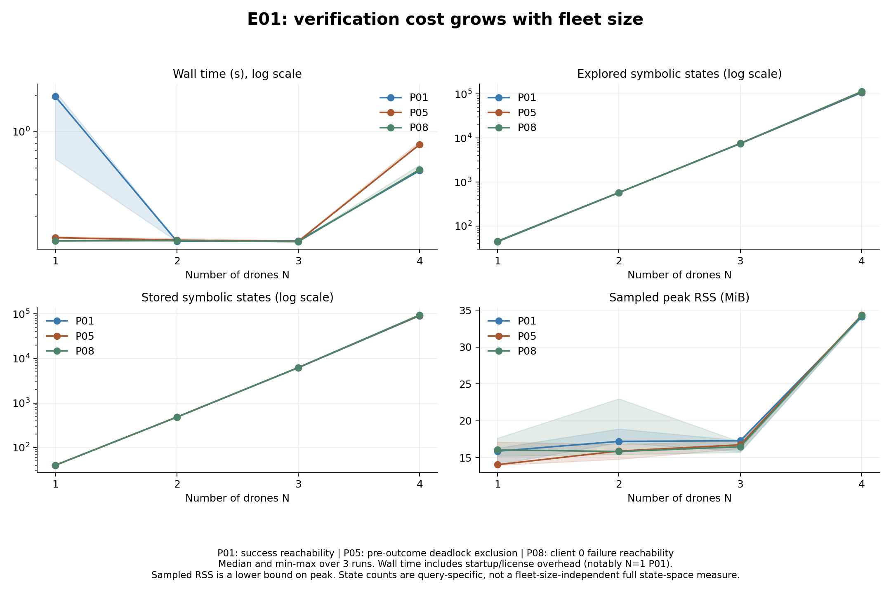

# E01：无人机规模实验结果

2026-11-25。使用 UPPAAL 5.1.0-beta6 的 verifyta，Python 负责配置生成、调用、记录、校验与绘图。原始 08 模型未修改。

## 设计与完成情况

比较 N=1、2、3、4；其他条件固定为每架 3 个任务项、传输时间 1–3、ACK 超时 14、最多重传 2 次、无丢包、无心跳。随 N 同步生成任务发送/接收实例与 system 组合；任务完整性和全队重试查询覆盖全部实际实例。

每个规模运行 14 条性质：P01–P09、P13–P16、P23。3 轮共 168 次正式查询，全部完成，未触及 120 秒或 8 GiB 资源限制。三轮性质结果及探索/存储状态数完全一致。另生成一条 N=4 的 P17 见证，独立于性能测量。

## 行为结果

| N | 成功可达 P01 | 任一无人机触发重试 P23 | 任一无人机确认失败 P15 | 所查安全、完整性与进展性质 |
|---:|---|---|---|---|
| 1 | 是 | 否 | 否 | 满足 |
| 2 | 是 | 否 | 否 | 满足 |
| 3 | 是 | 是 | 否 | 满足 |
| 4 | 是 | 是 | 否 | 满足 |

表中最后一列指 P02–P07、P13、P14、P16。P05 允许 Done/Aborted 的终止状态，P06 单独检查入网包最终离开；P16 的前提是到达 Prepared。不能据此改写为“从初始状态无条件保证全队成功”。P08（无人机 0 失败）与 P09（无人机 0 重试）的结果也分别与全队 P15/P23 相同。

在此次固定参数下，增加到 3 架时开始允许超时重试，但增加到 4 架还不足以产生重试耗尽。不能把“机群变大”直接写成“必然失败”，也不能把 N≤4 的结果推广到更大机群、丢包或心跳负载下。

## 验证成本

以 P05“终态前无死锁”为例：

| N | 探索状态数 | 存储状态数 | 墙钟耗时中位数（秒） | 采样 RSS 峰值中位数（MiB） |
|---:|---:|---:|---:|---:|
| 1 | 45 | 40 | 0.1326 | 14.05 |
| 2 | 576 | 481 | 0.1266 | 15.90 |
| 3 | 7,541 | 6,231 | 0.1236 | 16.74 |
| 4 | 112,482 | 92,776 | 0.7850 | 34.32 |

状态数随并发规模显著上升；本组 P05 从 3 架到 4 架，探索数约增至 14.9 倍。这是所选查询和验证设置下的观察，不是推导出的复杂度定律。

图中 P01、P05、P08 分别代表成功可达性、终态前死锁排除和无人机 0 失败可达性；阴影为 3 轮的最小—最大范围，线为中位数。状态数三轮一致。

较小模型的真实搜索工作很少，进程启动、许可证检查与轮询开销占比较大。尤其 N=1 的 P01 是每批第一个调用，墙钟时间显著偏高；不能把 N=2 时耗时下降解释为规模扩大提升性能。P05 的 CPU 用户时间中位数分别为 0、0、16、672 ms；0 ms 受计时分辨率影响，不是零计算成本。

内存是每 50 ms 采样得到的进程 RSS 峰值下界，并非精确内存峰值。P06/P16 的活性验证统计受工具提示限制，不使用其探索/存储状态与 CPU 汇总数据。全部原始指标仍可追溯到日志。

## N=4 的关键轨迹

P17 要求无人机 0 已收到 ARM 接受确认，且本次 ARM 的重试计数已经增加。见证满足，事件如下（相对于无人机 0 首次 ARM 准入）：

| 模型时间 | 事件 |
|---:|---|
| 0–3 | CMD0 占用网络 |
| 3–6 | CMD1 占用网络 |
| 6–9 | CMD2 占用网络 |
| 9–12 | CMD3 占用网络 |
| 12 | 无人机 0 执行抽象 ARM，ACK0 进入网络 |
| 14 | 客户端先走超时边，重试计数加一、进入 Sending |
| 14 | ACK0 随后到达，客户端经 Sending→Idle 接受确认 |

四个请求连续占用共享链路，使 ACK0 的交付落在超时边界。最终模型的迟到 ACK 处理允许这次交换结束。该轨迹没有第二次 CMD0 发送，所以“重试计数增长”不等于“已发生网络重传”；表中的重试均指计数增长可达。

## 证据与限制

见[实验包与命令](../experiments/E01_fleet_scaling/README.md)、[轨迹事件表](../results/coordination/analysis_E01/n4_retry_trace.md)和 results/coordination/analysis_E01 下的审计 JSON。验证了源模型、每个配置模型、查询、运行器快照哈希与原始日志判定；N=3 的 13 条重合性质与已有基线一致。扩展运行器后，原 E02/E03 模型生成结果保持字节一致。

最初空嵌入查询区导致一次工具错误，已保留且排除；最终实验副本提供安全的 GUI 示例查询，实际检查使用外部 queries.q。其余模板转移未更改。

本轮没有测试超过 4 架、心跳、丢包、公平调度或优化方案。下一项核心工作是 E05：从同一源模型生成心跳开/关的配对实验。
