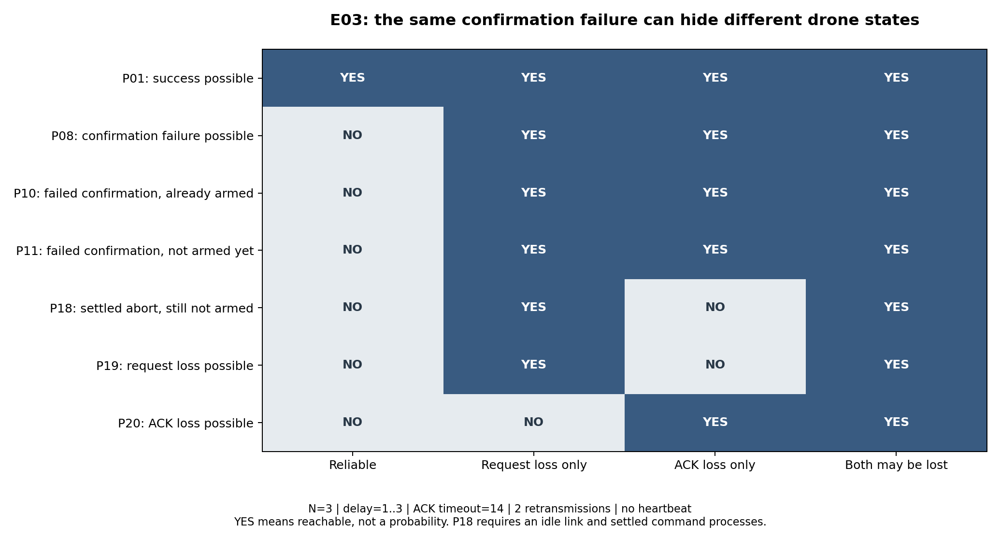

# E03: loss location and confirmation failure

2026-11-25. Python generated experiment variants from the unchanged version 08 source and invoked UPPAAL 5.1.0-beta6 verifyta. UPPAAL supplied all property verdicts; Python handled automation, recording, checks and plotting.

## Experimental scope

Settings were N=3, three mission items, D_MIN=1, D_MAX=3, ACK_TIMEOUT=14, MAX_RETRY=2 and inactive heartbeats. Only the packet kinds eligible for command-protocol loss changed. Timeout, retries, scheduling and mission-upload reliability were fixed. Four modes each received 22 checks, giving 88 queries. Another 21 checks used the original LOSSY=true setting, and four diagnostic witnesses were generated. All 113 calls completed without timeout or tool error.

The original LOSSY setting and the variant with both loss switches enabled agree on 21 properties. The split reliable mode agrees with the existing reference on 16 properties. These comparisons check the listed properties.

## Results

Yes and No indicate reachability.

| Question | Reliable | Request loss only | ACK loss only | Both |
|---|---|---|---|---|
| Is successful coordination possible? P01 | Yes | Yes | Yes | Yes |
| Is confirmation failure possible? P08 | No | Yes | Yes | Yes |
| Already armed at confirmation failure? P10 | No | Yes | Yes | Yes |
| Still unarmed at confirmation failure? P11 | No | Yes | Yes | Yes |
| Still unarmed after coordination aborts and command activity settles? P18 | No | Yes | No | Yes |

All four modes satisfy P02–P07, P13, P14, P16 and P21. The checked prerequisites, success evidence, mission integrity, pre-outcome deadlock restriction, packet progress, service window and eventual outcome after Prepared all hold. Success remains reachable even in modes that also admit failure.



P19/P20 confirm that the permitted lost packet kinds match each setting. P21 holds throughout: mission-upload messages are never dropped.

## Two principal witnesses

Times below are relative to drone 0's first ARM request admission, in model time units.

### Request loss: a command never executes

In the request-only P18 witness, CMD0 is sent at 0, 14 and 28 and lost at 3, 15 and 29. At 42, the waiting budget is exhausted and the supervisor aborts. The link and all three servers are Idle. Client 0 is Failed, the other clients are Idle, and `armed[0]=false`. No pending or in-flight command remains to change that state.

### ACK loss: execution without confirmation

In the ACK-only P10 witness, CMD0 is sent at 0, 14 and 28. At 17 and 31 the server takes its execution/reply edge and sets `armed[0]=true`; the corresponding ACK0 packets are lost at 18 and 32. At 42 the client enters Failed while the drone remains armed. Repeated ARM edges update the model's Boolean state.

## Timing and pending work

**Request-only loss can also yield execution without confirmation.** In the supplementary request/P10 trace, the first two requests are lost and the third is delivered. ARM executes at 40 and its ACK enters the link. Confirmation fails at 42 while the ACK remains in transit. Losses, remaining waiting time and link contention jointly determine the outcome.

**With ACK-only loss, ARM can still be pending at the instant of failure.** At the reply/P11 endpoint, server 0 remains in Decide while the link handles other traffic. The model applies ARM when the acceptance reply gains admission. Request delivery alone therefore does not immediately set `armed`. The added progress query P22 is:

```text
(cmdFailed[0][ARM] && !armed[0]) --> armed[0]
```

P22 is satisfied under ACK-only loss, and its premise is reachable through P11. A command still unexecuted at confirmation failure subsequently executes. P18 is false in this mode: the specified settled, unarmed abort state is unreachable. P22 is false under request-only and bidirectional loss. In reliable mode P22 holds with an unreachable premise.

Supervisor.Aborted stops further coordination but does not cancel commands already delivered to other components.

## Evidence and scope

See the [experiment package](../experiments/E03_loss_location/README.md) and [trace event tables](../results/coordination/analysis_E03/trace_events.md). Figures use recorded JSON results; event times accumulate raw-log Delay entries. Checks covered source/model/query/runner hashes, exit codes and logged verdicts. The version 08 source hash was unchanged.

The symbolic checks use fixed parameters and nondeterministic loss. P18 specifies a particular settled state. The study does not introduce loss probabilities or flight dynamics, and does not compare statistical runtime performance across loss modes.

The next studies planned at the time were E01 fleet scaling and E05 heartbeat activation. E04 bounded loss and retries was then an optional extension.
