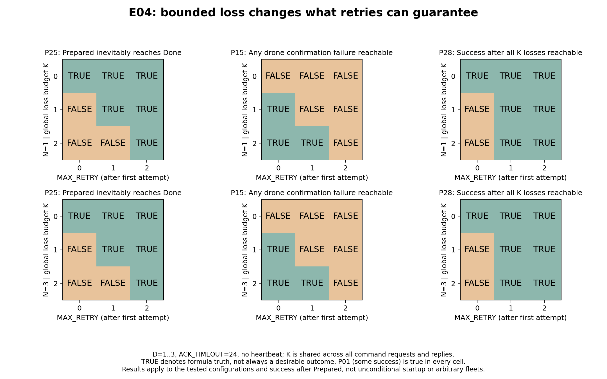
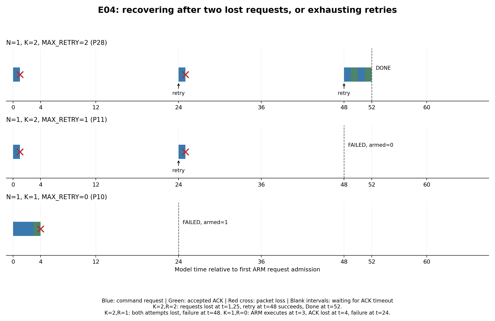

# E04: what retries guarantee under bounded loss

2026-11-25. This study made **392 calls** to UPPAAL 5.1.0-beta6. Every call returned a definite true/false verdict, without timeout, memory-limit stop or tool error. Python organized, archived and plotted the results. UPPAAL verified the properties. The original final model was unchanged.

## Findings and conditions

For N=1 and N=3, packet service 1–3, ACK timeout 24 and inactive heartbeats, the verifier established the following: if the coordination attempt loses at most K command-protocol packets and each command exchange permits at least K retries, **every execution reaching Prepared eventually reaches Done**. Done records receipt of every drone's START acceptance.

When R<K, both success and confirmation failure are reachable. Bounding the environment's total losses makes a recovery guarantee verifiable. With unrestricted loss, every tested finite retry allowance still permits failure.

The waiting budget also matters. In a control with ACK timeout restored to 14, confirmation failure is reachable even at N=3 and K=R=0. The recovery result therefore depends on the loss budget, timeout and shared-link scheduling together.

## Meaning of K and R

K is the **total loss budget shared by the whole coordination attempt**. It covers all drones, ARM and START requests, and acceptance/denial ACKs. It is not reset per drone, per command or on successful delivery. The network may lose any number from 0 to K. Mission-upload packets remain reliable.

R=`MAX_RETRY` is the **number of retransmissions permitted after the initial send in each command exchange**. R=2 allows one initial send and two retransmissions. The retry counter resets for the next command under the existing client logic.

The experiment variants add the network-local counter `lossCount`, initialized to zero and incremented only on Transmitting→Lost. That edge also requires `lossCount < LOSS_BUDGET`. Clients cannot read the counter; it constrains the communication environment.

## Comparison grid

The complete K={0,1,2} × R={0,1,2} grid was run at N=1 and repeated at N=3. Fixed settings were three mission items, D_MIN=1, D_MAX=3, ACK_TIMEOUT=24 and inactive heartbeats, with the final model's late-ACK handling retained. Timeout 24 came from the E02 settings excluding timing-only failure and was checked again at every K=0 retry setting.

The following matrix holds at both fleet sizes:

| Global loss budget K | R=0 | R=1 | R=2 |
|---:|---|---|---|
| 0 | Guaranteed completion after Prepared | Guaranteed completion after Prepared | Guaranteed completion after Prepared |
| 1 | Success and failure reachable | Guaranteed completion after Prepared | Guaranteed completion after Prepared |
| 2 | Success and failure reachable | Success and failure reachable | Guaranteed completion after Prepared |

Nineteen properties per configuration gave 342 main checks. P01 is true throughout. Where R≥K, P25 is true and fleet-wide failure reachability P15 is false. In the remaining cells, these two verdicts reverse. Drone-0 failure P08 and the armed/unarmed failure queries P10/P11 identify the same failure region.

P02–P07, P13, P14, P16, P21 and P27 hold in all configurations. These checks cover prerequisites, success evidence, mission integrity, pre-outcome deadlock freedom, eventual link release, service timing, eventual Done/Aborted after Prepared, permitted loss kinds and the loss-count bound.

P28 asks whether **success remains reachable after the entire loss budget has been consumed**. At K=2, R=1, P28 is true while P25 is false: some paths recover after both losses, but other permitted loss arrangements fail. At R=0 and K>0, P01 is true while P28 is false. The success witness can avoid packet loss entirely.

## Three diagnostic traces

These single-drone witnesses use time relative to the first ARM admission, in model time units.

| Configuration | Events | Endpoint |
|---|---|---|
| K=2, R=2 | Initial send at 0, request lost at 1; retransmission at 24, lost at 25; second retransmission at 48, ARM ACK received at 50; START then completes | Done at 52, with the loss budget exhausted |
| K=2, R=1 | ARM requests again lost at 1 and 25; only one retransmission is available | Client Failed at 48, armed=false, link and server idle |
| K=1, R=0 | Abstract ARM executes and its ACK is sent at 3; ACK lost at 4 | Client Failed at 24, armed=true |

The first two traces have the same two request losses. An additional retry allows recovery, consistent with the universal P25 result. The third extends E03's execution/confirmation distinction to bounded loss. At both failure-trace endpoints the supervisor is still Arming; the successful witness reaches Done.

## Additional controls

**Unrestricted loss.** At N=1 and R=0, 1 or 2, P01/P08/P10/P11 are true and P25 is false, giving 15 checks. These environments can discard every attempt, whereas the bounded grid restricts the total losses.

**Shorter timeout.** At N=3, K=R=0, changing ACK_TIMEOUT from 24 to 14 makes P01/P08/P10/P15 true and P25 false. ARM0 enters the link at relative time 0. Other drones occupy intervening slots, so ACK0 is admitted and ARM0 executes only at 12. At 14 the client fails while ACK0 remains in flight. The trace contains no packet loss.

**Starting condition.** The additional query `A<> Supervisor.Done` is false at N=1 and N=3 with K=R=0. A counterexample remains in initial Supervisor.Idle, whose location has no time bound and whose outgoing transition is not urgent. P25 instead checks progress from Prepared. P01 confirms success is reachable, and every path to Done passes through Prepared.

The reliable-link controls without a loss counter cover N=1 and N=3 and R=0, 1 or 2. Their 24 P01/P08/P15/P25 checks agree with K=0. A structural audit confirmed that the counter only controls the existing loss edge and leaves the other protocol templates unchanged.

## Evidence, cost and scope

The 392 calls comprise 342 main checks, 15 unrestricted-loss controls, 24 reliable-link controls, five short-timeout controls and six diagnostic checks. Queries ran sequentially with BFS, a 120 s limit and an 8 GiB limit. Trace queries were separate from routine measurements.

Each main query was measured once. Median wall time was 0.18555 s, maximum wall time 0.7327 s, and the sum over 342 checks 65.8817 s. Maximum sampled RSS was approximately 26.01 MiB. Startup and licence checks account for much of these short runtimes. RSS sampling every 50 ms bounds the peak from below. Liveness search/CPU summaries are excluded from comparisons.

The archive contains actual models, queries, commands, tool version/hash, runner snapshots, raw logs, per-query results, matrices and trace event tables. Audits checked input hashes, raw verdicts, counter-update placement and reliable controls. Twenty-five generated configurations from E01/E02/E03/E05 remained byte-identical. The source model SHA-256 remains `77896d59a2282f817786b7712f0d4372432fce73bc54a6bbed32500f3c40744d`.

- [Experiment package, queries and replay commands](../experiments/E04_bounded_loss/README.md)
- [Fixed run index](../experiments/E04_bounded_loss/evidence.json)
- [Trace event tables](../results/coordination/analysis_E04/trace_events.md)
- [Structured execution summary](../results/coordination/analysis_E04/execution_summary.json)

The result covers the tested N=1 and N=3, K/R≤2 and stated communication settings. Subsequent scheduling or timeout improvements can be compared against these conditions and counterexamples.
