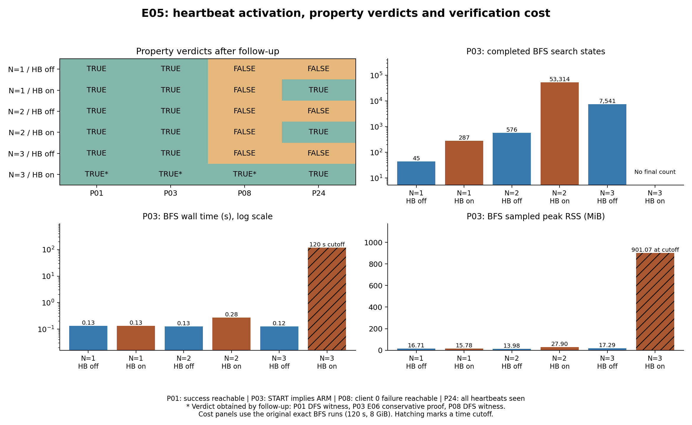
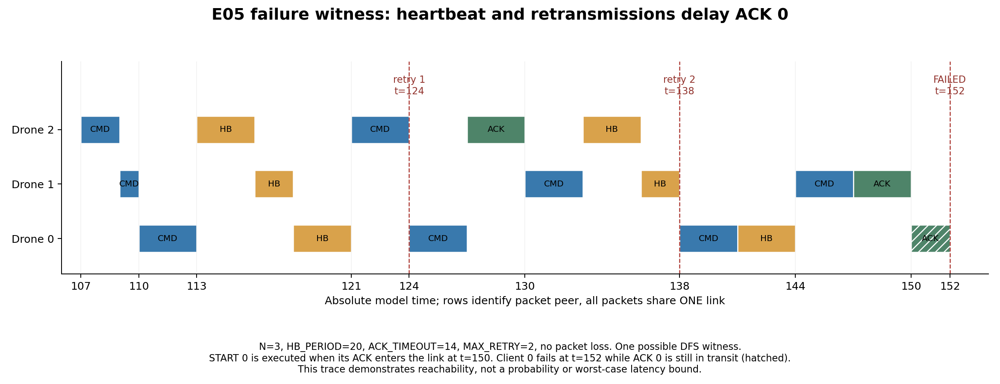
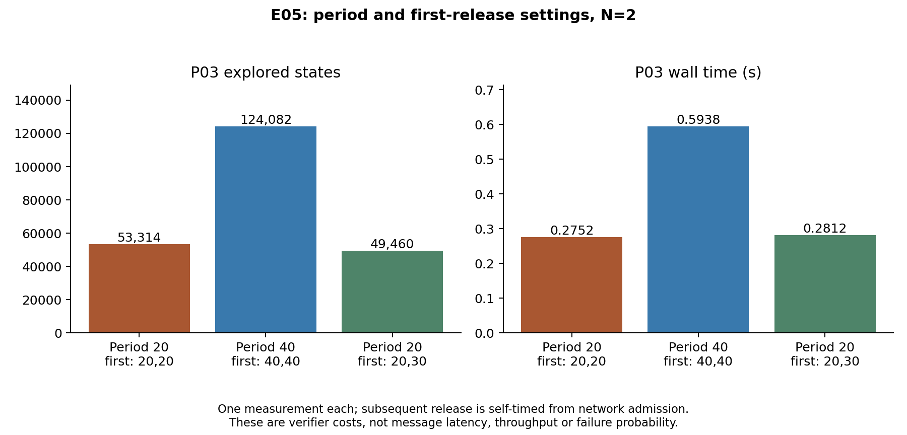

# E05: heartbeat traffic, confirmation failure and verification cost

2026-11-25. UPPAAL 5.1.0-beta6 verifyta supplied the verdicts. Python generated configurations, invoked the tool, archived results and plotted figures. The source `08_final_version.xml` was unchanged.

## Main findings

Enabling heartbeats in the final model preserves the checked START safety property at one and two drones, with drone-0 retry exhaustion unreachable. At three drones, both a successful path and a confirmation-failure path exist under reliable delivery. Heartbeats change the permitted behaviour and substantially increase the cost of some verification queries.

The failure witness shows START already executed when the ground-side client reports a missing confirmation. This is a reachable outcome under the tested single-link, nondeterministic scheduling and timeout settings.

## Experimental design

The main grid is N=1, 2, 3 × heartbeat off/on, with HB_PERIOD=20. Each pair differs only by adding `HBSender, ConnectionMonitor` to the system composition. Existing templates and late-ACK handling are retained. Fixed settings are three mission items per drone, D_MIN=1, D_MAX=3, ACK_TIMEOUT=14, MAX_RETRY=2 and LOSSY=false.

Each configuration checks four properties: P01 success reachability, P03 START requiring ARM, P08 drone-0 retry-exhaustion reachability, and P24 reachability of a state in which every drone's heartbeat has been received. A false P08 excludes failure. A false P24 is expected with heartbeat senders disabled.

Main queries run sequentially with BFS and limits of 120 s and 8 GiB each. Additional N=2 settings use period 40 or period 20 with staggered first releases. Each performance measurement is a single run. Extra DFS checks and diagnostic traces are archived separately from the BFS comparison.

## Verdicts and search budgets

The original BFS results are:

| N | Heartbeats | Success, P01 | START safety, P03 | Drone-0 failure, P08 | All heartbeats seen, P24 |
|---:|---|---|---|---|---|
| 1 | Off | True | True | False | False |
| 1 | On | True | True | False | True |
| 2 | Off | True | True | False | False |
| 2 | On | True | True | False | True |
| 3 | Off | True | True | False | False |
| 3 | On | Timeout, unknown | Timeout, unknown | Timeout, unknown | True |

On the identical N=3 heartbeat-on model, changing only BFS to DFS produced witnesses for P01 and P08. Both are true, with wall times 0.6179 and 0.9356 s respectively. These witnesses establish that success and failure are both reachable. The original BFS timeout records remain separate.

The P03 DFS follow-up also timed out, after 120.0487 s. E06 subsequently established P03 on the same original-scheduling model using conservative convex-hull over-approximation. P24 concerns reachability of heartbeat reception; universal progress of pending heartbeats is treated separately by E06 properties P30–P32. See the [E06 results](experiment_results_E06.md).

Extended follow-ups reran the same model, queries and BFS options in parallel with limits of 600 s and 2 GiB sampled RSS per query. P01, P03 and P08 reached the memory limit after 585.11, 588.00 and 584.21 s respectively. Their final verdicts follow from the DFS witnesses and E06 safety proof. The [follow-up summary](../results/coordination/analysis_E05/activation_followup.json) records original runs, extended searches and final verdicts.

## Matched verification cost

For P03:

| N | Heartbeats | Explored states | Stored states | Wall time (s) | Sampled peak RSS (MiB) |
|---:|---|---:|---:|---:|---:|
| 1 | Off | 45 | 40 | 0.1340 | 16.71 |
| 1 | On | 287 | 267 | 0.1321 | 15.78 |
| 2 | Off | 576 | 481 | 0.1261 | 13.98 |
| 2 | On | 53,314 | 24,687 | 0.2752 | 27.90 |
| 3 | Off | 7,541 | 6,231 | 0.1248 | 17.29 |
| 3 | On | Incomplete | Incomplete | 120.0532, timeout | 901.07 |

At N=2, enabling heartbeats increases explored symbolic states by about 92.6 times. At N=3, P01/P03/P08 all reach the 120 s limit with sampled RSS of approximately 901–908 MiB, below the 8 GiB cap. These measurements characterize the selected queries, search order and state representation.

The upper-left panel shows final verdicts, with asterisks marking the three-drone follow-up results. The three cost panels retain the original 120 s, 8 GiB BFS measurements.

Wall time includes startup, licence checks and polling. RSS is sampled every 50 ms. Timed-out checks have no complete explored/stored counts. Finding an existential witness with DFS requires different search work from establishing a universal safety property.

## Failure trace: ACK contention and retransmissions

The following segment is the N=3, period-20, reliable-link P08 DFS witness. Times are absolute model times from initialization.

| Time | Event |
|---:|---|
| 110 | Drone 0's START enters the link, starting its first 14-unit ACK window |
| 113 | The request arrives; the server enters Decide with its ACK still awaiting admission |
| 113–121 | Heartbeats from all three drones occupy consecutive slots while the ACK waits |
| 124 | Drone 0 times out and retransmits START |
| 124–138 | Retransmissions, other ACKs and subsequent heartbeats interleave on the link |
| 138 | Drone 0 times out again and retransmits START |
| 138–150 | Retransmissions, heartbeats, drone 1's request and ACK continue to occupy the link |
| 150 | Drone 0's ACK is admitted; the same server edge executes abstract START |
| 152 | The ACK remains in flight when the third waiting window expires; the client enters Failed |

At the endpoint, `started[0]=true`, `cmdFailed[0][START]=true`, and the link carries drone 0's START acceptance ACK. The supervisor remains Starting. The hatched final ACK is still in flight; the trace supplies no later delivery time.

This execution contains three actual START request transmissions. Every completed packet is delivered. Heartbeats and retransmissions repeatedly gain admission before the pending ACK. Late-ACK handling allows reception while retrying, but the allowed delay can still exhaust the waiting budget.

An N=2 success witness reaches Supervisor.Done at time 44 while a heartbeat pending since time 20 has not yet been sent. Heartbeat activation and success reachability alone therefore do not establish heartbeat delivery along that witness. P24 and the mixed-traffic N=3 trace supply separate reception evidence.

## Period and first-release comparisons

The three N=2 heartbeat-on settings all satisfy P01/P03/P24 and make P08 false.

| Setting | First eligible times | P03 explored states | P03 stored states | P03 wall time (s) | Sampled RSS (MiB) |
|---|---|---:|---:|---:|---:|
| Period 20 | 20, 20 | 53,314 | 24,687 | 0.2752 | 27.90 |
| Period 40 | 40, 40 | 124,082 | 30,455 | 0.5938 | 33.69 |
| Period 20, staggered first release | 20, 30 | 49,460 | 26,697 | 0.2812 | 27.89 |

The longer period increases explored states by about 2.33 times. Larger clock constants and different timing interleavings change symbolic exploration. Their individual contributions were not isolated in this study.

First-release staggering reduces explored states by about 7.2%, while stored states increase and wall time does not improve. This variant adds `firstOffset=floor(id*HB_PERIOD/N)` to the initial Waiting bound and clears it on first admission. Later periods restart at each admission, so the initial 10-unit offset is not permanently enforced. The P24 witness admits the two heartbeats at 20 and 30 and receives them at 23 and 31.

These timing variants were checked at N=2. The scheduling policy was unchanged in E05; ACK priority was proposed as a subsequent experiment using the same failure queries.

## Evidence and completed scope

The initial batch made 37 verifyta calls: 24 main checks, eight period/offset controls, four diagnostic traces and one DFS safety follow-up. Thirty-three returned definite verdicts and four reached their time limit. Of 32 BFS measurements, 29 completed and three timed out; the fourth timeout was DFS P03.

See the [E05 package](../experiments/E05_heartbeat/README.md) and [fixed evidence index](../experiments/E05_heartbeat/evidence.json). `results/coordination/analysis_E05` contains per-query audit records, three PNG/SVG figure sets, complete trace events and `failure_trace_summary.json`. Raw stdout retains states, transitions and delays.

Audits checked model/query/runner hashes, raw verdicts, timeout flags and search options. Each heartbeat pair changes only system composition. Heartbeat-off models are byte-identical to the matching E01 models and agree on shared properties. Seventeen earlier E01/E02/E03 configurations remained byte-identical. The source SHA-256 remains `77896d59a2282f817786b7712f0d4372432fce73bc54a6bbed32500f3c40744d`.

The completed scope includes activation comparisons, small-fleet period/first-offset comparisons and traffic-trace analysis. The selected safety query is P03, and failure reachability is checked for drone 0.
