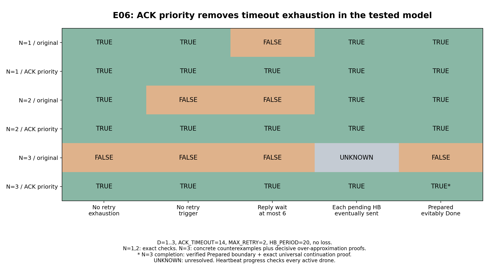
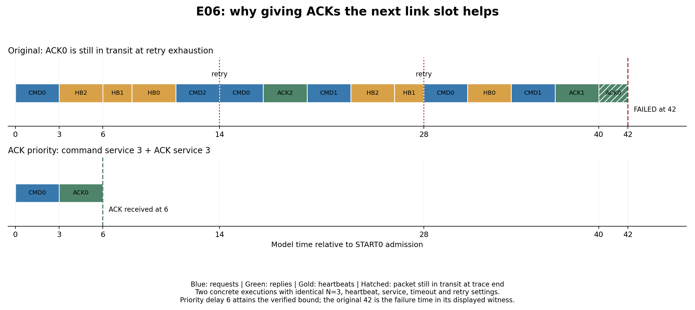

# E06：ACK 优先调度的改进实验

2026-11-25；2026-11-26 补充完成性证明。基于当前最终模型增加 ACK 优先规则，并使用 UPPAAL 验证。可直接打开的新模型为 [09_ack_priority.xml](../models/09_ack_priority.xml)。

## 改进结果

在 E05 的三架无人机、心跳周期 20、传输时间 1–3、ACK 超时 14、最多重试两次、无丢包配置下，加入 ACK 优先规则后：

- 所有无人机都不会因等待回复超时而耗尽重试。
- 所有命令客户端的重试计数始终为零。
- 命令入网后，等待回复的时间不超过 **6 个模型时间单位**。
- 每架无人机等待发送的心跳最终都能获得链路发送机会。
- 任务完整性、ARM/START 前置条件、成功确认一致性、入网包进展和终态前无死锁检查通过。

因此，本次改进解决了 E05 中已经找到的“心跳与重传拖延 ACK，导致重试耗尽”的问题。2026-11-26 的补充验证进一步证明三架情况下 Prepared 后必然 Done：先验证完整模型的 Prepared 状态边界，再对覆盖全部后续行为的副本进行精确验证。具体方法及状态覆盖论证见[完成性证明](experiment_results_E06_completion.md)。

## 具体改了什么

链路空闲时，如果有命令 ACK 等待发送，就先让 ACK 入网；没有 ACK 等待时，其他消息按原方式竞争。正在传输的包照常完成。

实现使用 `ackPending[i]` 记录服务端是否位于 Decide。收到命令并进入 Decide 时设为 true，发送接受或拒绝 ACK 时清为 false。网络的六条非命令 ACK 入网边增加“所有 ackPending 都为 false”的守卫。P29 验证标记与服务端位置始终一致。

任务、命令、心跳和主管流程保持现有逻辑。ARM/START 仍在服务端把接受 ACK 交给网络时执行，因此 ACK 提前准入也提前了这一步动作。

## 与原调度的对照

固定 ACK_TIMEOUT=14、D_MIN=1、D_MAX=3、MAX_RETRY=2、HB_PERIOD=20，心跳开启、丢包关闭。每架有三个任务项。

| N | 调度 | 重试耗尽 | 触发重试 | 入网后回复时间≤6 | 每架待发心跳最终发出 | Prepared 后必然 Done |
|---:|---|---|---|---|---|---|
| 1 | 原调度 | 不会 | 不会 | 不成立 | 成立 | 成立 |
| 1 | ACK 优先 | 不会 | 不会 | 成立 | 成立 | 成立 |
| 2 | 原调度 | 不会 | 可能 | 不成立 | 成立 | 成立 |
| 2 | ACK 优先 | 不会 | 不会 | 成立 | 成立 | 成立 |
| 3 | 原调度 | 可能 | 可能 | 不成立 | 本轮未确定 | 不成立 |
| 3 | ACK 优先 | 不会 | 不会 | 成立 | 成立 | 成立（补充分阶段证明） |

1、2 架的结果来自精确验证。三架的原模型反例来自精确搜索，改进模型的安全性质和心跳进展由保守过近似得到确定的满足结论。图中 TRUE* 表示三机 Prepared→Done 的补充分阶段证明。

另做了一个只记录 ackPending、没有优先守卫的对照。其 N=2 的九条重合性质与原调度一致，新增的标记一致性检查也通过。由此确认记录状态的变量没有改变这些行为，改进来自入网优先规则。

## 为什么回复时间变为 6

命令包入网后最多传输 3 个时间单位。命令到达服务端，ACK 成为待发消息；链路释放后，其他请求和心跳先等待，ACK 获得下一次发送机会，再最多传输 3 个时间单位。

因此，命令入网到回复的路径变为“命令传输 + ACK 传输”。验证的计时上界是 `2*D_MAX=6`，低于当前超时 14。计时从命令获得网络准入开始。

P37 检查所有客户端在 WaitAck 时的时钟都不超过 6；P06 检查入网包最终离开；P35/P36 分别证明没有重试耗尽和重试计数增长。P38 还找到了 ACK 恰好在第 6 个时间单位送达的轨迹，因此 6 在该配置中能够达到。

## 实际轨迹

图中分别使用原模型的一条失败轨迹和改进模型的一条回复用时为 6 的轨迹，均从无人机 0 的 START 请求入网开始计时。

| 相对时间 | 原模型轨迹 | ACK 优先轨迹 |
|---:|---|---|
| 0–3 | START0 请求传输 | START0 请求传输 |
| 3–6 | 心跳等消息占用链路，ACK 等待 | ACK0 传输，在 t=6 收到回复 |
| 14 | 第一次超时并重传 | 这次交换已经完成 |
| 28 | 第二次超时并重传 | 这次交换已经完成 |
| 40 | ACK0 才获得网络准入 | — |
| 42 | 客户端重试耗尽，ACK0 仍在传输 | — |

原轨迹复用 E05 的实际记录，改进轨迹是本轮新生成的 UPPAAL 见证。完整事件、模型时间和消息种类保存在分析目录。两种调度也都找到了 Supervisor.Done 且全部心跳已收到的路径。

## 验证方法与完成情况

三架心跳模型的精确探索仍比较昂贵：首次检查全队无失败及 Prepared→Done 均达到 120 秒；更换精确状态表示和外推方式后，Prepared→Done 也达到时间上限。随后使用 UPPAAL 的凸包保守过近似验证。

保守过近似扩大被检查的行为集合。在扩大后的集合中仍证明安全性质成立，结论也适用于原模型；工具返回 MAY/MAY NOT 时，结果记为未确定。该判读依据 [UPPAAL 的过近似说明](https://uppaal.org/benchmarks/)和[验证结果说明](https://docs.uppaal.org/gui-reference/verifier/verifying/)。

三架改进模型的 P02–P07、P13、P14、P29–P32、P35–P37 均获得确定的满足结论。11 月 25 日的 Prepared→Done 过近似结果为 MAY NOT；当时分解后的命令完成、ARM 阶段、START 阶段进展也未确定，Prepared→Arming 已证明。11 月 26 日通过检查 Prepared 的完整状态边界，并对包含任意心跳相位及在途心跳的后续副本精确验证 `A<> Done`，补上了 P25 的证明。

11 月 25 日的分析集保留 **100 条查询记录**：87 条得到确定答案，3 条超时，10 条过近似结果未确定。每条限 120 秒、8 GiB，当时的验证器顺序执行。11 月 26 日的补充证明和尝试单独索引，不改写历史记录；部分补充查询与延长后的完整查询同时运行。模型生成和解析器调试记录单独保留。

在相同过近似设置下，P03 的一次测量为：

| 三架模型 | 探索状态 | 存储状态 | 墙钟秒 |
|---|---:|---:|---:|
| 原调度 | 2,722,596 | 1,087,331 | 19.8023 |
| ACK 优先 | 318,619 | 267,941 | 1.5468 |

原调度的 P03 也在本轮补充证明成立，补上了 E05 中该查询的未知结果。表中是单次验证成本，墙钟包含启动开销。

## 交付与复现

- [可直接在 UPPAAL 打开的改进模型](../models/09_ack_priority.xml)
- [实验设置、查询和复现命令](../experiments/E06_ack_priority/README.md)
- [固定证据索引](../experiments/E06_ack_priority/evidence.json)
- [三机完成性证明及补充证据](experiment_results_E06_completion.md)
- [实际轨迹事件表](../results/coordination/analysis_E06/trace_events.md)
- [执行汇总](../results/coordination/analysis_E06/execution_summary.json)

已校验原始日志判定、输入哈希、优先规则的六条入网边、标记更新与位置一致性，以及 43 个历史配置的生成回归。交付模型与被验证的三架改进副本仅在查询列表和守卫文字坐标上不同。08 基线文件保持原样。
