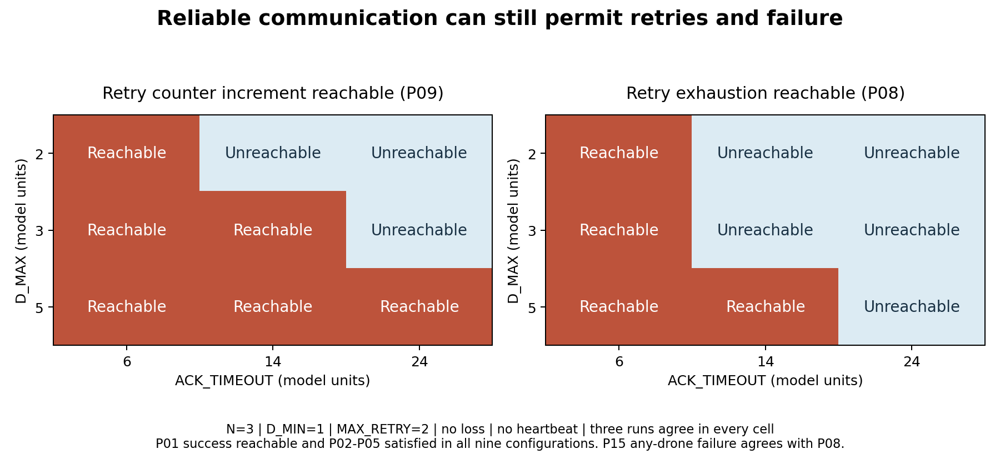
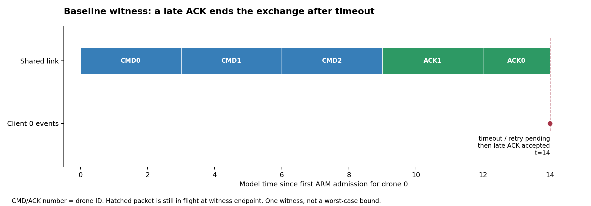
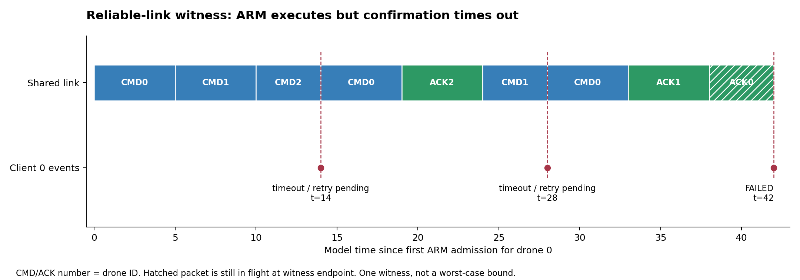

# Reference model and E02: first experiment results

2026-11-24. Chen's experiment work, with Codex assisting implementation and execution.

## Completed scope

The study used `08_final_version.xml` from main commit `2ecefd2`, without modifying the source model, and a locally licensed UPPAAL 5.1.0-beta6 installation. The reference study checked P01–P16 once. E02 checked eight properties in each of nine configurations, repeated three times, giving 216 checks. All 232 formal records completed without timeouts, memory-limit stops or tool errors. All three E02 repetitions produced identical property verdicts. Diagnostic traces and supplementary checks were archived separately from these 232 measurements.

Fixed settings were three drones, three mission items per drone, D_MIN=1, MAX_RETRY=2, no packet loss, inactive heartbeats and a single shared link slot. Timing parameters use model time units.

Methods, replay commands and log indexes are in the [experiment package](../experiments/coordination/README.md). This record describes the first completed batch; later experiments are documented separately.

## Reference results

The reference uses D_MAX=3 and ACK_TIMEOUT=14.

| Property | Verdict | Meaning |
|---|---|---|
| P01 | Satisfied | A successful coordination path exists |
| P02–P04 | Satisfied | ARM/START prerequisites and success-confirmation records are consistent |
| P05 | Satisfied | Deadlock is possible only at Done/Aborted; post-outcome cleanup is outside this query |
| P06 | Satisfied | Every admitted packet eventually leaves the link |
| P07 | Satisfied | Service outcomes respect the configured timing window |
| P08 | Not satisfied | Drone 0 cannot exhaust its retry budget |
| P09 | Satisfied | A retry-counter increment is reachable |
| P10, P11 | Not satisfied | Neither ARM confirmation-failure state is reachable |
| P12 | Not satisfied | Packet loss is unreachable, consistent with LOSSY=false |
| P13, P14 | Satisfied | Done agrees with actual started flags; confirmed missions are complete |
| P15 | Not satisfied | No drone can reach ARM/START confirmation failure |
| P16 | Satisfied | Prepared eventually leads to Done or Aborted |

P16 establishes progress from Prepared. P01 establishes the existence of a successful path.

## E02: interaction between delay and timeout

Each cell below reports “P09 retry increment reachable / P08 retry exhaustion reachable”. P15, which checks failure of any drone, agrees with P08 in every configuration.

| D_MAX / ACK_TIMEOUT | 6 | 14 | 24 |
|---|---|---|---|
| 2 | Yes / Yes | No / No | No / No |
| 3 | Yes / Yes | Yes / No | No / No |
| 5 | Yes / Yes | Yes / Yes | Yes / No |

All nine configurations satisfy P01 and P02–P05. Thus, the four configurations admitting failure also admit success. These verdicts describe the behaviours allowed by the nondeterministic model.

The grid distinguishes no retry, possible retry without exhaustion, and possible retry exhaustion. Increasing the timeout changes these outcomes within the tested grid. At D_MAX=5 and timeout 24, retries remain possible even though failure is excluded.

## Trace A: a late ACK in the reference model

Supplementary property P17 requires drone 0's ARM to have been accepted while the current command remains ARM and its retry counter is positive. The property is satisfied.

Taking drone 0's first ARM admission as relative time 0, corresponding to absolute trace time 24:

1. 0–3: CMD0 is transmitted.
2. 3–6 and 6–9: CMD1 and CMD2 occupy the link in succession.
3. 9–12: ACK1 occupies the link.
4. 12: drone 0 executes abstract ARM and ACK0 enters the link.
5. 14: the client takes its timeout edge, enters Sending and increments its retry counter. ACK0 then arrives at the same model time and is accepted on Sending→Idle.

This witness contains one CMD0 transmission. The P09 counter increment occurs before the client sends another request. The trace shows the race at the timeout boundary and the effect of the final model's late-ACK reception edge.

## Trace B: execution without confirmation on a reliable link

At D_MAX=5 and ACK_TIMEOUT=14, P08 supplies the failure witness below. A separate P10 check is satisfied, confirming reachability of execution without timely confirmation.

Time is relative to the first CMD0 admission:

| Relative time | Event |
|---:|---|
| 0 | CMD0 is sent and the ACK timer starts |
| 14 | First timeout; CMD0 is retransmitted and the timer resets |
| 28 | Second timeout; CMD0 is retransmitted again |
| 38 | Drone 0 executes ARM and ACK0 enters the link |
| 42 | The third waiting window expires; the retry budget is exhausted and the client enters Failed |

At the endpoint, `armed[0]=true` and `cmdFailed[0][ARM]=true`. ACK0 remains in flight with service-clock value 4, within D_MAX=5. Link contention and the permitted service order delay the reply; every completed transmission is delivered. Time 42 is this witness's endpoint. Hatching denotes the ACK still in flight.

## Evidence and measurement

- Model, query and runner-snapshot hashes, declared parameters, exit codes and raw-log verdicts were checked. Every E02 configuration/property pair has three matching verdicts.
- Wall time includes process startup and licence checks. The runs are short, so small timing differences are dominated by overhead. Verifier CPU time is parsed separately; a reported 0 ms reflects timer resolution.
- Process RSS is sampled every 50 ms, giving a lower bound on peak memory. Unsupported or unavailable statistics remain empty.
- The Windows verifier rejected the original non-ASCII path. Execution used hash-checked copies under an ASCII temporary path. The initial path failures remain recorded as tool errors.
- beta6's `-X` trace export produced nonzero exit codes and empty XML files. Those attempts supplied no verification verdict. Switching to `-t 0` produced complete text traces.
- Diagnostic traces are separate from timing measurements. Figure times are obtained by accumulating Delay entries from the raw traces; event data and original lines are also stored as JSON.

## Next stage recorded at the time

The next planned study was E03, separating request loss from ACK loss and using the reference settings together with E02's timing-failure boundary. E01 fleet scaling and E05 heartbeat comparisons were to follow. E04 bounded loss was then an optional extension.
