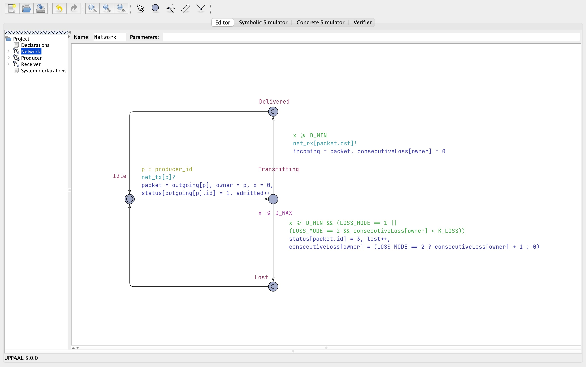
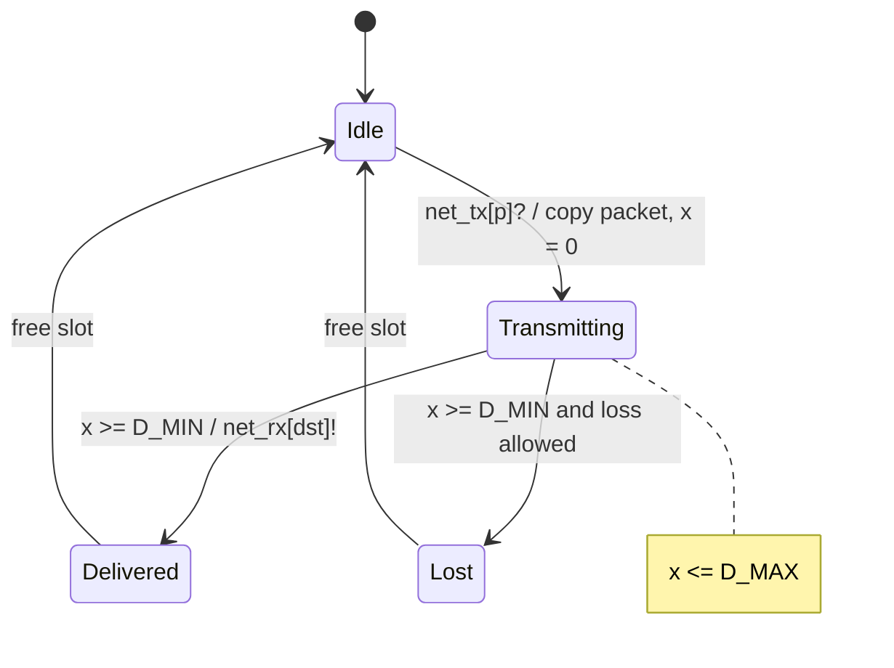

# Network model: notes and results

## What I am modeling

The network is one shared link between the two sides. It carries one packet at a time, in either direction. A packet waits at its producer until the link accepts it. After that it stays in the link for `D_MIN` to `D_MAX` time units and then it is either delivered or lost. One time unit is 100 ms. The numbers are just small test values, I did not measure them and they are not MAVLink defaults.

Group question: "Under which communication and timing conditions can a ground control station safely coordinate multiple drones, using mission transfer, command handling, and heartbeat monitoring?"

Project description: "Development of a timed automata model in UPPAAL of a MAVLink based multi-drone coordination system. We formally specify its correctness requirements and verify how communication failures and shared network resources affect those requirements."

This file is only about the network part, so it doesn't answer the whole question yet.

## The four locations

This is the network template in the editor, not a verification result.

`Idle` means the slot is free. `Transmitting` means one packet is in the link. It is a normal location, so time can pass there. `x` is reset when the packet is taken, and the guard `x >= D_MIN` together with the invariant `x <= D_MAX` gives the service window. `Delivered` and `Lost` are committed and only do bookkeeping, then the link goes straight back to `Idle`.

The receiver stub is always ready, which is an assumption of this test. If delivery was blocked at `D_MAX` and loss was switched off, the invariant wouldn't help and the model would just get stuck.

## The test harness

There are two test producers with two packets each. Producer 0 sends packets 0 and 1 to receiver 1 and producer 1 sends packets 2 and 3 to receiver 0, so both directions use the same slot. While the link is busy a producer waits in the normal `Waiting` location. The receivers take every packet straight away and compare it with the copy the producer made. They are only test stubs, not drone controllers. Loss is written down for the queries, but the producer is never told that its packet was lost.

## Example traces

The three traces in `results/network_runs/` come from `verifyta -t 0` on the unrestricted-loss copy (`lossy.xml`).

In `delivery_trace.log` both producers prepare their first packet. The link takes packet 0 from producer 0 and resets `x`, and producer 0 prepares packet 1 while the link is busy. After 1 time unit the link delivers packet 0 to receiver 1, which checks the fields.

`loss_trace.log` starts the same way, but after 1 time unit the link goes to `Lost`. No receiver gets packet 0.

`contention_trace.log` also starts the same way and stops when both producers have a packet waiting and the link is still busy with packet 0.

## What I checked

The 18 queries are in the XML and in `queries/network_queries.q`. All saved runs used `verifyta` from UPPAAL 5.0.0 (rev. 714BA9DB36F49691). Every run has two producers, four packets, `D_MIN = 1`, `K_LOSS = 1` and an always-ready receiver. The model copies, SHA-256 hashes, results per query, runtimes and logs are in `results/network_runs/` and `results/network_results.csv`.

| Run | Loss mode | D_MAX | What happened |
|---|---:|---:|---|
| Reliable | 0 | 3 | Delivery reachable. Loss and losing all packets not reachable. |
| Unrestricted loss | 1 | 3 | Delivery and loss both reachable. Losing all four packets also reachable. |
| Bounded loss | 2 | 3 | Loss reachable. Losing all four is not reachable with one consecutive loss per test flow. |
| Slower reliable link | 0 | 5 | Delivery reachable. Loss not reachable. |

Only N2 (a loss is possible), N15 (all packets lost) and the N18 value change between runs. All the other queries were satisfied in all four runs: integrity, no duplicates, accounting, the service window, the slot always being freed, the deadlock check and contention (both producers waiting while the slot is busy). So in this small test every packet ends up delivered or lost. N14 checks that neither test flow loses both of its packets. It only tests something in the bounded-loss run. In the other modes it is trivially true.

For N18, the longest `Sender1.Waiting` clock value was 9 units with `D_MAX = 3` and 15 units with `D_MAX = 5`. The CSV shows `9:` and `15:` because that's how `verifyta` prints a `sup` result. This is the admission wait, so the time before the link takes the packet. It doesn't include the time in the link and it isn't an end-to-end command deadline. Producer 1's second packet can wait behind its own first packet and both of producer 0's packets, so 3 x 3 = 9, or 3 x 5 = 15 with the slower link. Separate reachability checks also found states at exactly those values, but those runs were not saved, so the evidence in `results/` is the `sup` result. The numbers depend on this small workload and on `net_tx` being urgent, so they don't prove any fairness in general. The controllers and the heartbeat are not in this test, so it says nothing about them.

N9 (the clock stays under `D_MAX`) is basically the invariant again, so on its own it doesn't show progress. That's why it goes together with N10 (the packet always leaves the slot) and N11 (deadlock check). UPPAAL counts the end of the test as a deadlock because no transitions are left. N11 only allows that state when both senders are done, the link is idle and all four packets are delivered or lost. A plain `A[] not deadlock` is not in the saved runs. It would fail at that normal end because nothing can move anymore. In the first version of the harness the producers could also put off preparing a packet forever. Making `Prepare` urgent fixed that, but it is only a test harness choice and doesn't mean a real producer always sends.

## Run it

1. Open `models/network_model.xml` in UPPAAL. The `Network` template is the diagram, `Producer` and `Receiver` are the test environment.
2. In the Verifier tab, run the embedded queries. The file is set to unrestricted loss (`LOSS_MODE = 1`). For another mode, change `LOSS_MODE` in the declarations, save a separate copy and run it again.
3. Or run `python3 scripts/run_network_checks.py` from the project folder. It writes the four model copies, the logs, the three traces and the CSV. If UPPAAL is installed somewhere else, set `UPPAAL_VERIFYTA` to the path of `verifyta` first.
4. To repeat only the unrestricted-loss run: `~/Applications/UPPAAL-5.0.0.app/Contents/app/bin/verifyta models/network_model.xml queries/network_queries.q`.

The network diagram has also been viewed in the UPPAAL desktop editor. The simulator still needs a manual check. The saved traces are verifier output, not simulator recordings.

The model copies in `results/network_runs/` are from before the comments were cleaned up. The declarations, edges and queries are the same apart from comments, but the edited file has a different hash and still needs a successful rerun. A later attempt failed because UPPAAL could not retrieve its license. The runner overwrote the old reliable-run log and version log before stopping; those original logs are unavailable. The old CSV results and model snapshots remain, and the failed output is marked in `results/network_runs/README_rerun.txt`.

To check that the queries can actually fail, temporary copies were changed to corrupt a delivered payload, to let a producer put off preparing forever, and to reset both loss counters when either flow delivers. The integrity, progress and bounded-loss queries failed on those copies like they should. These copies and their logs were not saved and the changes are not in the model.

## What is still missing

The group's mission/command models and the heartbeat are not connected to this component. There is no bounded shared queue, no scheduling policy, no retry protocol, no physical radio and no measured packet timings. This model can't show flight safety, MAVLink conformance or success under unlimited loss. The results have to be repeated once we agree on the interfaces and the receiver behaviour as a group.

## References used for the UPPAAL semantics

- [UPPAAL: edges and synchronization](https://docs.uppaal.org/language-reference/system-description/templates/edges/), for channel synchronization and updates.
- [UPPAAL: locations](https://docs.uppaal.org/language-reference/system-description/templates/locations/), for invariants, urgent and committed locations.
- [UPPAAL: symbolic queries](https://docs.uppaal.org/language-reference/query-syntax/symbolic_queries/), for the query forms used above.
