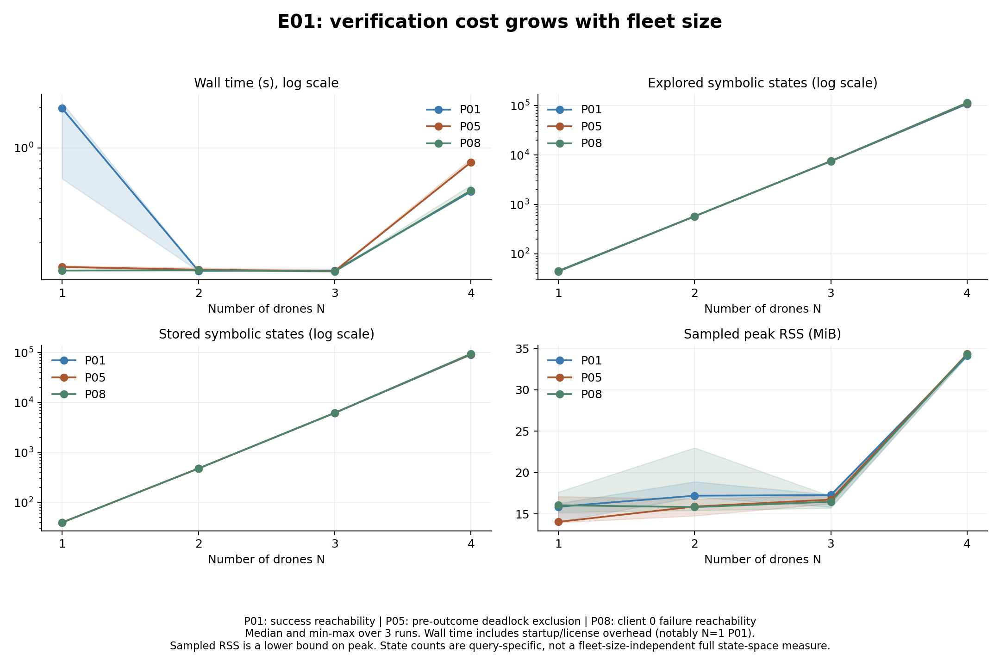

# E01 机群规模 / Fleet scaling

## 设计 / Design

从 08 基线生成 1、2、3、4 机模型，每架保持 3 个任务项，使用同一个单槽链路，传输时间 1–3，ACK 超时 14，每次命令最多重传两次。关闭丢包和心跳，使规模成为唯一比较因素。随规模同时调整任务收发进程和逐机查询。每组精确 BFS 验证 14 条性质，重复三轮，共 168 次检查。

We generated fleets of one to four drones from version 08. Each drone had three mission items, shared a single link with service times of 1–3, and used an ACK timeout of 14 with up to two retries per command. Loss and heartbeat were disabled to isolate fleet size. Mission processes and per-drone queries were generated for each size. Exact breadth-first verification checked 14 properties per fleet with three repetitions, for 168 checks.

## 性质与成本 / Properties and cost

机群从 1 架增加到 4 架时，确认失败始终不可达（P15）。重试计数增长从 3 架开始可达（P23）。三轮的性质判定与状态计数一致，P01 在四个规模均找到成功路径，所查前置条件、任务完整性和有条件的协调进展均满足。 [逐查询结果](results/records.csv)

Confirmation failure remained unreachable (P15) as the fleet grew from one to four drones. Retry counter increments became reachable at three drones (P23). Verdicts and state counts agreed across three repetitions. A successful execution existed at every fleet size (P01), and the checked prerequisites, mission integrity and conditional coordination progress held. [Per-query results](results/records.csv)

| N | 任一重试计数可增长 / Any retry increment reachable | 任一确认失败可达 / Any failure reachable | P05 探索 / Explored | P05 存储 / Stored | 墙钟中位数 / Median wall (s) |
|---:|---|---|---:|---:|---:|
| 1 | 否 / No | 否 / No | 45 | 40 | 0.1326 |
| 2 | 否 / No | 否 / No | 576 | 481 | 0.1266 |
| 3 | 是 / Yes | 否 / No | 7,541 | 6,231 | 0.1236 |
| 4 | 是 / Yes | 否 / No | 112,482 | 92,776 | 0.7850 |

P05 的探索状态从 3 架到 4 架增加约 14.9 倍。前三个规模的墙钟时间接近进程启动开销，状态数更能体现这几组的搜索差异。 [三轮指标](results/analysis/scaling_summary.json)

P05 explored about 14.9 times as many states at four drones as at three. Wall times for the three smaller fleets are close to process startup overhead, so state counts give a clearer comparison of search effort. [Three-run metrics](results/analysis/scaling_summary.json)

四机 P17 见证中，四条请求依次占用链路。以第一条请求准入为起点，ACK0 在 t=12 入网，在 t=14 的超时边之后同一时刻送达。客户端计数加一后从 Sending 接受了回复，这条轨迹实际只发送了一次 CMD0。 [轨迹事件表](results/analysis/n4_retry_trace.md)

In the four-drone P17 witness, four requests used the shared link in sequence. Relative to the first admission, ACK0 entered the link at t=12 and arrived at t=14, immediately after the timeout transition at the same model time. The counter increased, and the client accepted the reply from Sending. This trace contains one CMD0 transmission. [Trace events](results/analysis/n4_retry_trace.md)

## 结果分析 / Interpretation

P14 检查各架已确认的任务都包含全部任务项，P16 检查从 Prepared 出发最终到达 Done 或 Aborted。这两条在四个规模均满足。P23 和 P15 将两个调度后果区分开来：三机起，更多请求可排在 ACK 之前并触发超时，但本组参数下剩余等待机会仍足以排除重试耗尽。四机轨迹还说明，同一时刻的事件顺序会影响重试计数。

P14 checked that every confirmed mission contained all its items. P16 checked that Prepared eventually led to Done or Aborted. Both held at every fleet size. P23 and P15 distinguish two scheduling effects. From three drones onward, extra requests can precede an ACK and trigger a timeout, while the remaining attempts in these settings still exclude retry exhaustion. The four-drone trace also shows how the ordering of events at the same model time can affect the counter.

三轮正式查询均在 120 秒、8 GiB 限制内结束。曲线上的阴影是三轮最小值到最大值，状态数三轮相同。活性查询 P06、P16 的状态累计统计不用于规模成本比较。

All three repetitions finished within 120 s and 8 GiB per query. Shading shows the minimum and maximum across repetitions. State counts agreed across all three. The scaling comparison uses state counts from the selected reachability and safety checks.
