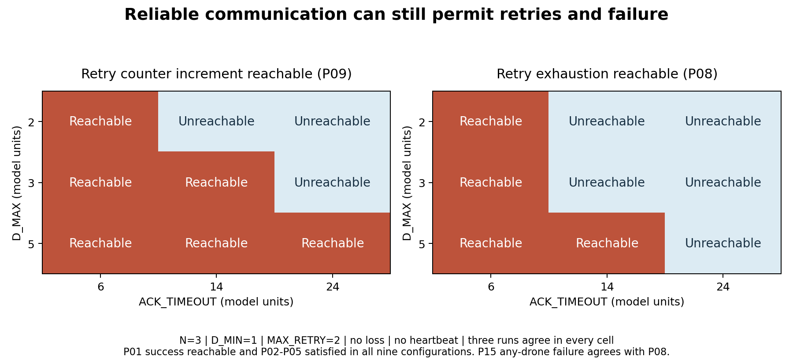

# E02 网络延迟与超时 / Delay and timeout

无丢包时，9 个延迟与超时组合中有 4 个允许确认失败。每组都存在成功路径（P01），且 P02–P05 均满足。216 次网格查询的三轮判定一致。 [矩阵数据](results/analysis/E02_matrix.json)

On a reliable link, four of the nine delay and timeout combinations admitted confirmation failure. A successful execution existed in every cell (P01), and P02–P05 held throughout. The 216 grid query results agreed across the three repetitions. [Matrix data](results/analysis/E02_matrix.json)

每格为重试计数增长（P09）与确认失败（P08）是否可达。P15 的全队失败判定与 P08 一致。  
Each cell gives reachability of a retry counter increment (P09) and confirmation failure (P08). The fleet-wide failure verdict (P15) matched P08.

| D_MAX / ACK_TIMEOUT | 6 | 14 | 24 |
|---:|---|---|---|
| 2 | 是 / 是 · Yes / Yes | 否 / 否 · No / No | 否 / 否 · No / No |
| 3 | 是 / 是 · Yes / Yes | 是 / 否 · Yes / No | 否 / 否 · No / No |
| 5 | 是 / 是 · Yes / Yes | 是 / 是 · Yes / Yes | 是 / 否 · Yes / No |

基线 D_MAX=3、ACK_TIMEOUT=14 的迟到 ACK 见证中，客户端在 t=14 先触发超时，随后在同一模型时刻接受 ACK0，期间没有再次发送 CMD0。D_MAX=5、ACK_TIMEOUT=14 的失败见证中，CMD0 在 t=0、14、28 入网，t=38 执行 ARM 并将 ACK0 交给网络，t=42 客户端耗尽等待预算时 ACK0 仍在途。时间以首次 CMD0 准入为起点。 [基线轨迹](results/figs/baseline_late_ack.png) · [失败轨迹](results/figs/reliable_failure.png)

In the reference case with D_MAX=3 and ACK_TIMEOUT=14, the client took its timeout edge at t=14 and accepted ACK0 at the same model time before sending CMD0 again. With D_MAX=5 and ACK_TIMEOUT=14, CMD0 entered the link at t=0, 14 and 28. ARM executed and ACK0 entered the link at t=38. At t=42 the client exhausted its wait budget while ACK0 was still in transit. Times are relative to the first CMD0 admission. [Reference trace](results/figs/baseline_late_ack.png) · [Failure trace](results/figs/reliable_failure.png)

同一链路服务窗口下，ACK_TIMEOUT 从 14 增至 24 可排除测试网格中的确认失败。在 D_MAX=5 时仍允许触发重试，说明排除重试耗尽所需的超时与排除所有重试所需的超时可以不同。

Increasing ACK_TIMEOUT from 14 to 24 excluded confirmation failure throughout the tested grid at fixed service windows. With D_MAX=5, a retry could still be triggered. The timeout needed to exclude exhaustion can therefore differ from the timeout needed to exclude all retries.
