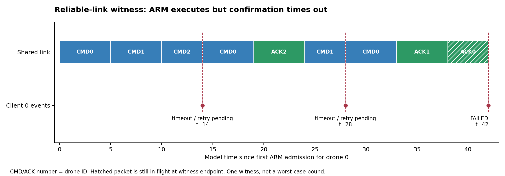

# E02 Delay and timeout

## Design

We crossed the maximum link service time D_MAX with the client ACK_TIMEOUT on a reliable three-drone link with heartbeat disabled. We checked retry triggers, retry exhaustion and coordination safety. The client starts its timer at request admission. Its reply wait includes request transmission, waiting for reply admission, and reply transmission.

## Results and traces

On a reliable link, four of the nine delay and timeout combinations admitted confirmation failure. A successful execution existed in every cell (P01), and P02–P05 held throughout. The 216 grid query results agreed across the three repetitions. [Matrix data](results/analysis/E02_matrix.json)

Each cell gives reachability of a retry counter increment (P09) and confirmation failure (P08). The fleet-wide failure verdict (P15) matched P08.

| D_MAX / ACK_TIMEOUT | 6 | 14 | 24 |
| ---: | --- | --- | --- |
| 2 | Yes / Yes | No / No | No / No |
| 3 | Yes / Yes | Yes / No | No / No |
| 5 | Yes / Yes | Yes / Yes | Yes / No |

In the reference case with D_MAX=3 and ACK_TIMEOUT=14, the client took its timeout edge at t=14 and accepted ACK0 at the same model time before sending CMD0 again. With D_MAX=5 and ACK_TIMEOUT=14, CMD0 entered the link at t=0, 14 and 28. ARM executed and ACK0 entered the link at t=38. At t=42 the client exhausted its wait budget while ACK0 was still in transit. Times are relative to the first CMD0 admission.

Increasing ACK_TIMEOUT from 14 to 24 excluded confirmation failure throughout the tested grid at fixed service windows. With D_MAX=5, a retry could still be triggered. The timeout needed to exclude exhaustion can therefore differ from the timeout needed to exclude all retries.

At timeout 6, failure was reachable for all three service bounds. At timeout 14, increasing D_MAX moved the result from no retry to possible retry and then to possible failure. Even with D_MAX=2, where an uncontended request and reply take at most four time units, other drones can take link slots between them. P10 confirmed that ARM could already have executed at confirmation failure with D_MAX=5 and ACK_TIMEOUT=14. All 16 reference checks and 216 grid checks returned decisive verdicts. [Per-query results](results/records.csv)
