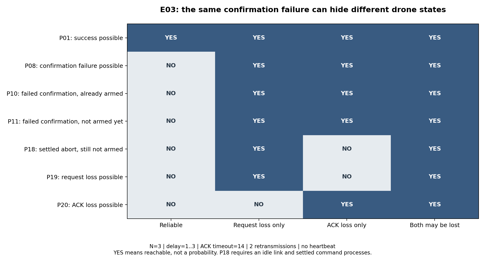

# E03 Loss location

The same confirmation failure can occur with ARM already executed or still unexecuted. Distinguishing the cases requires the ground station's confirmation state, the drone state and messages still in transit.

The three-drone model used reference timing and disabled heartbeat. Separate switches determine whether requests and command ACKs can take the network's loss transition. Mission traffic remains reliable. P19 and P20 check reachability of each type of loss, and P21 checks that mission packets are never lost. All 113 invocations were decisive, including 22 checks in each mode, 21 legacy-switch controls and four diagnostics.

| Query | Reliable | Request only | ACK only | Either |
| --- | --- | --- | --- | --- |
| P01 Success reachable | Yes | Yes | Yes | Yes |
| P08 Failure reachable | No | Yes | Yes | Yes |
| P10 Armed at failure | No | Yes | Yes | Yes |
| P11 Unarmed at failure | No | Yes | Yes | Yes |
| P18 Settled abort while unarmed | No | Yes | No | Yes |

In the request-only P18 witness, all three ARM requests were lost. At t=42 coordination aborted, the link and servers were idle, and drone 0 was unarmed. In the ACK-only P10 witness, ACKs were lost after ARM execution. The client again failed at t=42, with the drone armed. Both timelines begin at the first ARM request admission. [Trace events](results/analysis/trace_events.md)

With ACK loss only, P11 was reachable and P22 held. Executions that were still unarmed at failure subsequently reached ARM. The server can receive the request and wait to execute ARM until its reply enters the link. P22 failed when requests could be lost. Its premise was unreachable in the reliable control. [P22 formula and evidence](code/queries/README.md#p22)

Request-only loss also admitted an execution with ARM complete at failure. In the P10 witness, the first two requests were lost and the third arrived. The server executed ARM and admitted its ACK at t=40. The client failed at t=42 while the ACK remained in transit. Request loss and reply contention can therefore combine to cause confirmation failure. P18 checks a settled state with an idle link and the specified command processes quiescent, which distinguishes this ongoing execution from one in which all three requests were lost. [Trace events](results/analysis/trace_events.md)
