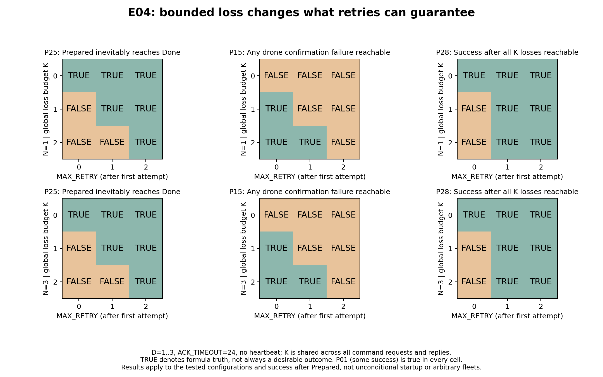
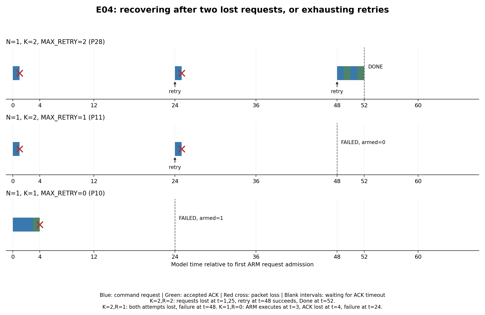

# E04 Bounded loss and retries

## Design

K is shared by all drones, both commands and both command packet directions. The network increments its counter only on a loss, and the count carries across successful deliveries and command changes. R sets the retry limit per command exchange. The main study uses service times of 1–3, heartbeat off and ACK timeout 24. It checks nine K and R pairs for each of N=1 and N=3.

## Recovery and failure

Across the 18 single-drone and three-drone configurations with ACK_TIMEOUT=24, P25 held in the 12 configurations with R≥K. The six configurations with R<K allowed both success and confirmation failure. K caps losses across the whole coordination attempt, and R caps retries after each initial command. [Matrix data](results/analysis/outcome_matrix.json)

In a single-drone witness, the first two requests were lost at t=1 and t=25. With R=2, the third attempt received the ARM ACK and reached Done at t=52. With R=1, a matched sequence exhausted its wait budget at t=48. P28 also found a successful execution at K=2, R=1 that used the full loss budget. That configuration admits both recovery and failure.

The third trace has K=1 and R=0. The server executed ARM at t=3, the ACK was lost at t=4, and the client failed at t=24. Even a single lost packet can therefore leave a drone armed when confirmation fails. Time in the plot begins at the first ARM request admission.

With timeout 14, the three-drone control admitted confirmation failure even at K=R=0. P25 failed for R=0, 1 and 2 under unrestricted loss. The initial Idle counterexample to P26 shows that startup remains a choice in the model environment. P25 guarantees completion once Prepared is reached. [Controls and diagnostics](results/records.csv)

## Control results

P01 held in all 18 cells, establishing a possible successful execution in every setting. With R≥K, P25 held and P15 excluded confirmation failure anywhere in the fleet. The K=0 verdicts agreed with 24 checks on a reliable link without a loss counter. The short-timeout control shows that completion also depends on the timing budget. All 342 main checks and 50 controls or diagnostics returned decisive results.
