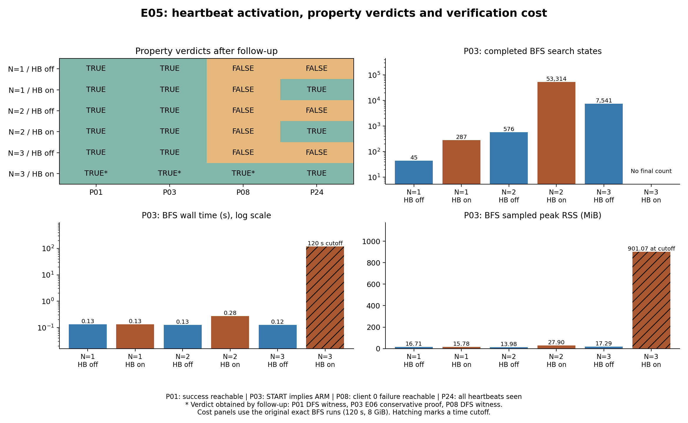
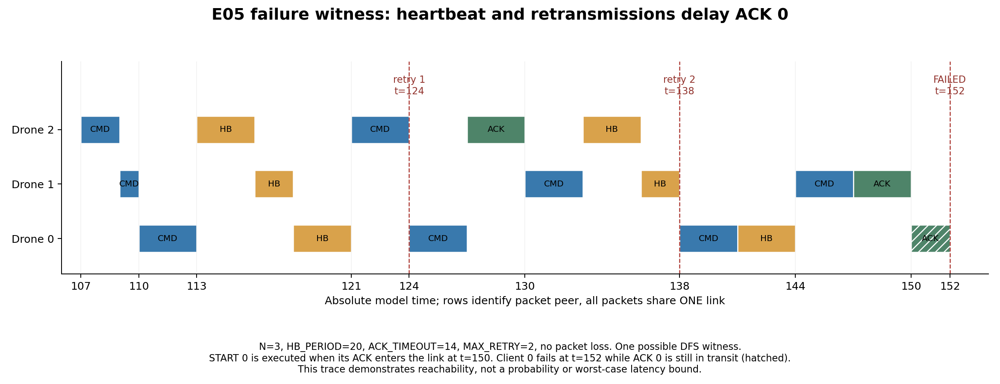
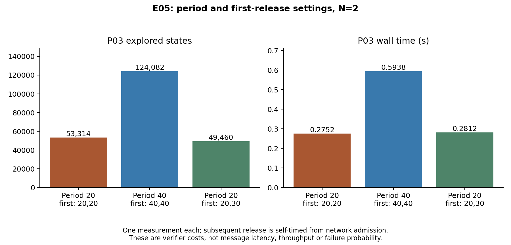

# E05 心跳流量 / Heartbeat traffic

开启心跳后，三机原调度在无丢包条件下出现确认失败见证，同时成功仍可达。单机和双机开启心跳时，P08 排除了无人机 0 的确认失败。

With heartbeat enabled, original scheduling admitted a three-drone confirmation failure on a reliable link. Success also remained reachable. For one and two drones with heartbeat, P08 excluded confirmation failure for drone 0.

## 设计与配对结果 / Design and paired results

对 N=1、2、3 使用同一个 08 源模型，通过系统组合启用或停用心跳发送和接收进程。每对固定传输时间 1–3、ACK 超时 14、最多重传两次和无丢包链路。周期为 20，从上次心跳获得链路时隙开始计时。除 P01、P03 和 P08 外，P24 检查地面站能否至少收到每架无人机的一次心跳。

For N=1, 2 and 3, we paired models built from the same version 08 source by enabling or disabling heartbeat sender and receiver processes. Service times of 1–3, ACK timeout 14, up to two retransmissions, and no packet loss were fixed. The period is 20 and restarts at each heartbeat admission. In addition to P01, P03 and P08, P24 checks whether a state exists in which at least one heartbeat from every drone has been received.

左上矩阵汇报最终判定。星号标出原来超时、后来获得结论的三条性质。其余三个面板保留原来统一使用 120 秒、8 GiB 上限的 BFS 测量，三机开启心跳的 P03 因此仍标出 120 秒截止和当时的内存用量。

The upper-left panel shows final property verdicts. Asterisks mark the three properties resolved after the initial timeouts. The three cost panels retain the original BFS measurements with a 120 s, 8 GiB budget. They show the cutoff and the memory measured at that point for P03 with three drones and heartbeat enabled.

## 失败见证 / Failure witness

三机见证中，START0 在 t=110 入网，t=113 送达。心跳、其他命令和重传占用后续链路时隙。t=150，ACK0 获得发送机会，服务端执行 START。t=152，客户端进入 Failed，ACK0 仍在传输，主管仍位于 Starting。 [原始轨迹事件](results/analysis/traffic_traces.md)

In the three-drone witness, START0 entered the link at t=110 and arrived at t=113. Heartbeats, other commands and retransmissions took subsequent link slots. At t=150, ACK0 gained admission and the server executed START. At t=152, the client entered Failed while ACK0 was still in transit and the supervisor was in Starting. [Trace events](results/analysis/traffic_traces.md)

## 验证成本与参数对照 / Verification cost and parameter controls

N=2 的 P03 探索状态由 576 增至 53,314，约为原来的 92.6 倍。心跳周期从 20 改为 40 后增加到 124,082，首次错开后为 49,460，但错开后的存储状态由 24,687 增至 26,697。周期和释放相位改变了符号状态的时间交错，三个设置的查询真值一致。首次错开仅移动第一轮发送条件，之后各发送者仍按自身准入时间重新计时。

For N=2, P03 explored 53,314 states with heartbeat, about 92.6 times the 576 states with heartbeat disabled. Period 40 increased this to 124,082. Staggered first releases gave 49,460 explored states, with stored states increasing from 24,687 to 26,697. Period and release phase changed symbolic timing interleavings while query verdicts agreed across all three settings. Staggering changes the first release only. Each sender subsequently restarts its timer at its own admission.

## 三机开启心跳的补充验证 / Three-drone heartbeat follow-up

对原图的 P01、P03、P08 使用逐字节相同的模型、查询和 BFS 选项重跑。三条并行运行，每条最多 600 秒和 2 GiB 采样 RSS，均先触及内存上限。下表同时给出延长搜索的停止情况和最终判定所用证据。 [补查记录](results/analysis/activation_followup.json)

We reran P01, P03 and P08 using byte-identical models and queries and the original BFS options. Each of the three concurrent searches had a 600 s time limit and a 2 GiB sampled RSS cap. All three reached the memory cap first. The table gives the stop reason and the evidence for each final property verdict. [Follow-up records](results/analysis/activation_followup.json)

| 查询 / Query | 延长 BFS / Extended BFS | 最终判定 / Final verdict | 判定证据 / Decisive evidence |
|---|---|---|---|
| P01 成功可达 / Success reachable | 585.11 s，内存上限 / memory cap | 真 / TRUE | 精确 DFS，0.62 s，找到 Done / exact DFS witness to Done |
| P03 START 必须以 ARM 为前提 / START requires ARM | 588.00 s，内存上限 / memory cap | 真 / TRUE | E06 对同一模型的保守过近似，19.80 s / E06 conservative proof on the identical model |
| P08 无人机 0 确认失败可达 / Drone 0 confirmation failure reachable | 584.21 s，内存上限 / memory cap | 真 / TRUE | 精确 DFS，0.94 s，找到 Failed / exact DFS witness to Failed |

P01 和 P08 的见证是不同执行：有的调度能完成全队确认，有的调度会让无人机 0 耗尽重试。P03 则检查所有执行中的前置条件，E06 的同模型安全证明给出确定结果。 [逐查询记录](results/records.csv) · [P03 验证输出](results/analysis/P03_conservative_proof.txt)

The P01 and P08 witnesses show different executions. Some schedules complete fleet coordination, while others exhaust the retries for drone 0. P03 checks the prerequisite across all executions. The E06 safety proof on the same model establishes this property. [Per-query results](results/records.csv) · [P03 verifier output](results/analysis/P03_conservative_proof.txt)
