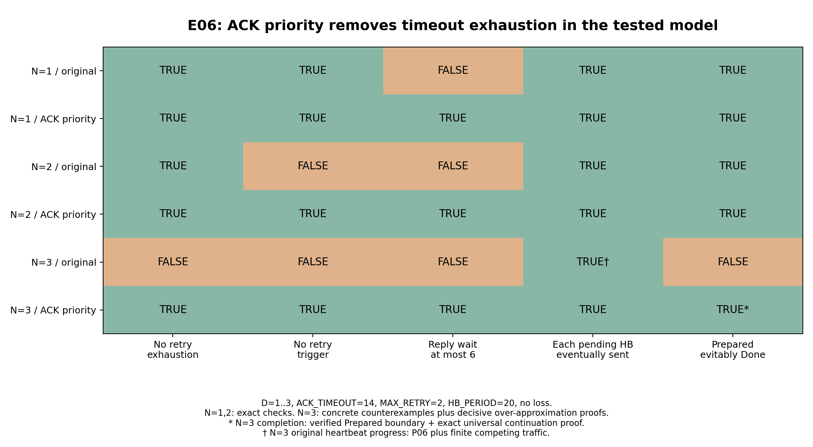
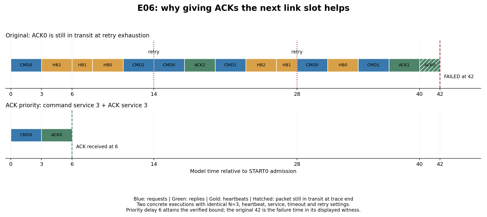

# E06 ACK 优先调度 / ACK-priority scheduling

三机开启心跳时，ACK 优先排除了 E05 中的确认失败和超时重试（P35、P36），使命令准入后的回复等待上界为 6 个模型时间单位（P37）。两种调度都保证待发心跳最终获得链路，区别在于原调度允许回复被拖延到重试耗尽，而 ACK 优先为回复保留了下一个可用时隙。

With three drones and active heartbeat, ACK priority excluded the confirmation failure and timeout retries observed in E05 (P35, P36) and bounded the post-admission reply wait at six model time units (P37). Both policies guarantee eventual admission of pending heartbeats. Under original scheduling, contention can delay a command reply until retries are exhausted. The priority policy gives that reply the next available slot.

## 调度改了什么 / Scheduling change

对照固定三机、每架 3 个任务项、单槽链路、时延 1–3、心跳周期 20、ACK 超时 14、最多重传两次和无丢包。服务端收到命令后进入 Decide，设置待发标记 `ackPending`，在接受或拒绝 ACK 获得链路时清除。链路空闲且存在待发 ACK 时，心跳、任务包和新命令先等待。正在传输的包正常完成。P29 证明标记与 Decide 一致，双机被动标记对照的九条共同性质与原调度判定一致。

The comparison fixes three drones, three mission items per drone, a single link slot, service times of 1–3, heartbeat period 20, ACK timeout 14, up to two retries and no loss. A server sets `ackPending` on receiving a command and entering Decide, then clears it when an acceptance or denial ACK is admitted. With an ACK pending, heartbeat, mission and new command traffic wait for a free slot after the reply. The current packet completes normally. P29 confirms the flag matches Decide, and the two-drone passive flag control agrees with original scheduling on its nine shared checks.

## 改进后的性质 / Verified effects

| 三机结果 / Three-drone result | 原调度 / Original | ACK 优先 / ACK priority |
|---|---|---|
| 任一确认失败 / Any confirmation failure | 可达 / Reachable | 不可达 / Unreachable |
| 回复等待 ≤6 / Reply wait ≤6 | 不成立 / Fails | 成立 / Holds |
| 每架待发心跳最终准入 / Eventual admission of each pending heartbeat | 成立，补充证明 / Holds, follow-up proof | 成立 / Holds |
| Prepared 后必到 Done / Prepared leads to Done | 不成立 / Fails | 成立 / Holds |

命令包送达后，待发 ACK 获得下一个链路时隙。命令和回复各最多传输 3 个单位，P38 的精确见证达到 6。原调度的 START0 见证中，客户端在 t=14 和 t=28 重传，ACK 在 t=40 才进入链路，客户端于 t=42 失败，此时 ACK 仍在途。两条轨迹均以各自首次 START0 准入为计时起点。

When a command arrives, its pending ACK gets the next link slot. The command and reply each take at most three units, and the exact P38 witness attains six. Under original scheduling, the START0 witness retransmits at t=14 and t=28. Its ACK enters the link at t=40, and the client fails at t=42 while that ACK is still in transit. Each trace measures time from its own first START0 admission.

## 状态空间与验证成本 / State space and verification cost

同样验证三机 P03（START 必须以 ARM 为前提），两种模型均使用 BFS 与相同的保守凸包过近似设置，均得到满足判定。

Both three-drone models satisfied P03, which checks that START requires ARM, using breadth-first search and the same conservative convex-hull over-approximation.

| P03 指标 / Metric | 原调度 / Original | ACK 优先 / ACK priority | 降幅 / Reduction |
|---|---:|---:|---:|
| 探索状态 / Explored states | 2,722,596 | 318,619 | 88.3% |
| 存储状态 / Stored states | 1,087,331 | 267,941 | 75.4% |
| 验证墙钟时间 / Verification wall time | 19.80 s | 1.55 s | 92.2% |

原调度允许不同数量的心跳、重传和其他命令穿插在请求及回复之间。优先规则排除了有待发 ACK 时由这些包占据下一时隙的分支。P03 的验证因此探索了更少的状态。表中是匹配设置下的 P03 搜索量和一次耗时测量。 [逐查询结果](results/records.csv)

Original scheduling allows varying numbers of heartbeats, retransmissions and other requests to interleave between a request and its reply. Priority removes branches in which those packets would take the next slot while an ACK is pending. The P03 search visited fewer states. The table reports the search counts and one wall-time measurement for the matched P03 checks. [Per-query results](results/records.csv)

## 原调度的心跳进展 / Heartbeat progress under original scheduling

P30–P32 分别检查各架无人机的心跳进入 Pending 后，是否最终获得链路准入。初次过近似查询约 0.13 秒即返回 `MAY NOT`。后续用普通 DBM 和 LU 外推仍返回 `MAY NOT`。改用默认外推和精确状态表示后，P30 达到 600 秒上限。补充验证在同一原调度模型上证明 P06，即在途包最终释放链路。结合心跳周期和有限业务量，推出三架的待发心跳最终准入。

P30–P32 ask whether each drone's heartbeat eventually gains admission after entering Pending. The initial over-approximate checks returned `MAY NOT` after roughly 0.13 s each. Plain DBMs with LU extrapolation also returned `MAY NOT`. The P30 run with exact state representation and automatic extrapolation reached its 600 s limit. A supplementary check proved P06 on the same original-scheduling model: every in-flight packet eventually releases the link. The heartbeat period and the finite volume of other traffic then establish eventual pending-heartbeat admission for each of the three drones.

目标心跳 Pending 时，紧急同步使空闲链路不能闲等。任务上传与命令交换总共最多入网 60 个非心跳包。其余两架各自相邻心跳准入至少间隔 20 个单位，每包最多占链路 3 个单位。因此，即使在每个可选时隙都优先挑选其他包，其他流量也无法无限占满链路。由时间和包数的关系可推出一个保守上界 270 模型单位。 [证明与验证输出](results/proof/Original_heartbeat_progress.md)

While the target heartbeat is pending, urgent synchronization prevents idle waiting on a free link. At most 60 mission and command packets can be admitted. Each of the other two drones spaces its heartbeat admissions by at least 20 units, and a packet occupies the link for at most three units. Even a scheduler that chooses competing packets first at every opportunity cannot keep the link occupied indefinitely. The packet and time bounds give a conservative upper bound of 270 model units. [Proof and verifier output](results/proof/Original_heartbeat_progress.md)

## 命令阶段完成性 / Command-phase completion

三机 Prepared → Done 由两项验证共同建立。完整模型验证 Prepared 时上传已经完成、命令尚未启动。后续模型覆盖 Prepared 时任意心跳相位、待发心跳及一条可能在途的心跳，精确验证 A<> Done 通过。两项检查分别耗时约 8.36 和 2.89 秒。直接验证完整模型的长时运行在约 814 秒主动停止，当时尚无判定。 [状态覆盖证明](results/proof/Prepared_to_Done.md)

The three-drone Prepared-to-Done claim follows from two checks. The full model verifies that mission upload is complete and commands have yet to begin at Prepared. The continuation model covers arbitrary heartbeat phases, pending heartbeats and a possible heartbeat already in flight. Its exact A<> Done check passed. The checks took about 8.36 and 2.89 seconds. The extended direct check of the full model was stopped at about 814 seconds before issuing a verdict. [State-coverage proof](results/proof/Prepared_to_Done.md)

这项结果把准入后的回复时限和整段命令流程的完成性连接起来。保证适用于当前三机、心跳周期 20、无丢包配置，Done 表示地面站已收到全队 START 接受确认。 [实际改进模型](code/models/09_ack_priority.xml)

The result establishes both a post-admission reply bound and completion of the command phase. It applies to the tested three-drone configuration with heartbeat period 20 and no packet loss. Done records receipt of every drone's START acceptance by the ground station. [Improved model](code/models/09_ack_priority.xml)

## 运行记录中的未确定项 / Inconclusive runs

原试验的部分直接查询曾超时或返回 `MAY NOT`。原调度的 P35 后来有精确反例，P30–P32 由上面的补充论证确定。ACK 优先的 P25 由分阶段证明确定。P39–P43 是用来定位阶段进展的单独探索查询，原查询记录仍为未确定。以 120 模型时间单位为阈值的改进模型完成计时器，也没有得到经过验证的时限结论。

Several direct checks in the original study timed out or returned `MAY NOT`. An exact counterexample settled P35 under original scheduling, while the follow-up argument above settles P30–P32. The compositional proof settles P25 under ACK priority. The separate exploratory checks P39–P43 remain inconclusive in their original runs. The timer experiment for a 120-unit completion deadline under ACK priority also remains inconclusive.
